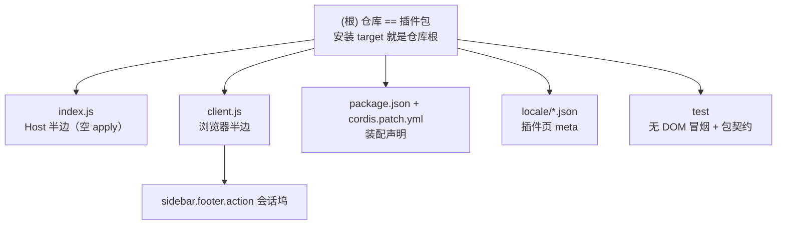

# AGENTS.md

给在这个仓库里干活的 agent 看的：命令、硬约束、改动连带项。面向用户的用法在 [README.md](README.md)，
设计取舍在 [IMPLEMENTATION.md](IMPLEMENTATION.md)。与代码冲突时以代码为准。

**仓库根就是插件包**：`package.json`、`index.js`、`client.js`、`cordis.patch.yml`、`locale/`、`icon.svg`
都在根目录，装哪个 profile 都指到仓库根，没有子目录、没有 monorepo。文档（README / IMPLEMENTATION /
本文件）与 `test/`、`.agents/` 也放在根，靠 `package.json` 的 `files` 白名单挡在包外。

## 变更记录 (Changelog)

| 日期 | 变更 |
|---|---|
| 2026-10-20 | 初始化架构文档体系：补「模块结构」图与「模块索引」，新增模块级 [running-sessions-float/AGENTS.md](running-sessions-float/AGENTS.md) 与 [.agents/index.json](.agents/index.json)。下方原有命令、硬约束、连带项一字未改。 |
| 2026-10-20 | 发版一致性核对：「改动连带项」的版本行补「未发版期间允许无 tag，README 必须写明」；`.agents/index.json` 改记 `versionSource` 而非版本值，避免多出第 4 处副本。 |
| 2026-10-20 | 版本号纠偏：首版按阶梯定为 `0.1.0`（原 `1.0.1` 与仓库实际阶段不符）；`package.json`、README 版本行、README 预期输出三处同步；tag 当时未创建，README 暂写明「尚未打 git tag」。 |
| 2026-10-20 | 发布 `0.1`：提交并打附注 tag `0.1`（指向首个正式版本），推送 main 与 tag；README 版本段从「尚未打 tag」改为钉版本示例。 |
| 2026-10-20 | README 对齐 `note/readme-spec.md`：补「不提供」清单、装法四条坑（含 tag 钉版本与 git 直装限制）、`--dump-config` 期望输出、扩展点表的 priority / patterns 列与「不占槽位」、排错补到 12 行、验证拆分写明 15 + 6 = 21。 |
| 2026-10-20 | README 安装章节按 `readme-spec` §2.3 重写：Web / git 源（本仓库不可用）/ link 三法 + 让 Agent 装；钉版本改为「克隆 + checkout tag」；装完确认给本机实测的 `--dump-config` 三行输出；四条坑含「清空 bundles 后装配为空」的实测证据；删掉「确认它真的在工作」里重复的装配块，改为指回本章。 |
| 2026-10-20 | 修正上述安装章节：方式二上一版抄漏了 `git+https://` 写法与 `# 或`、`# 钉版本` 三条命令的原有格式；现按 `readme-spec` 原样补齐，并把三条命令的实际结果（依赖名落成 `running-sessions-float#0.1`、版本 `0.0.0`，随后 `cannot resolve profile bundle`）写在命令下方。 |
| 2026-10-20 | 位置修正：坞从 `shell.overlay` 的固定浮层（`left: 10px / bottom: 76px`，会盖住列表）迁到官方 `sidebar.footer.action` 槽位、`order: -10`，成为侧栏底部动作区顶部的一块正常流；56px 窄栏改渲染 36px 计数圆片。同步 `client.js`、smoke（21 → 27 项）、README、IMPLEMENTATION、两份 AGENTS、`.agents/index.json` 与 locale meta。 |
| 2026-10-20 | 共存修正：坞挂载时给 `sidebar.footer.action` 那一行加 `flex-wrap: wrap`（`promoteFooterContainer`，另有等价 `:has()` 规则管首帧），生态里各入口的 `flex: 0 0 100%` 于是各占一行，用量统计 / 会话管理 / 搜索都排在坞下面。坞最高从 `min(46vh, 380px)` 收到 `min(28vh, 200px)`。**`flex-direction: column` 是错的**：列里 100% 按高度算，搜索入口涨成 256×139.95 把别人顶出屏幕（已在无头 Chrome 复现）。同步 `client.js`（368 → 429 行）、smoke（27 → 31 项）、README、IMPLEMENTATION、包内 AGENTS 与 `.agents/index.json`。 |
| 2026-10-21 | 完成未读：把 `useSessionStatus` 的第三个字段 `completionUnread` 纳入坞 —— 在主视图之外跑完的会话不再直接消失，行尾显示灰字「已完成」（与官方 `status.completed` 同词），显示优先级 待处理 > 运行中 > 已完成；坞头状态点在「只剩已完成」时换成静止的 6px 圆点（`rsf-settled`）。同步 `client.js`（429 → 465 行）、smoke（31 → 38 项）、README、IMPLEMENTATION、两份 AGENTS 与 `.agents/index.json`。 |
| 2026-10-21 | 修复点击导航：`uiWorkspace` 早先在 `apply` 时被一次性取值缓存，而它由启动更晚的 `dsh-client-ui-workspace` 提供，缓存到的是 `undefined` —— 于是**所有行点击都静默失效**（用户实测「已完成不能点击跳转」）。改成每次点击现取 + `try/catch`。冒烟补 4 条走 **inject face** 的断言（此前点击断言只测 prop 转发，绕过了插件自己的包装函数），并做过变异验证。`client.js` 465 → 477 行，smoke 38 → 42 项。 |
| 2026-10-23 | 包名改为 `@dongasai/running-sessions-float`（原 `@local/running-sessions-float`），与本机其它自研插件同 scope；版本抬到 `0.2.0`。**四处必须同步**：`package.json` 的 `name`、`cordis.patch.yml` 的 `name`、`client.js` 顶层的 `load({ id })`（smoke 有「client id 与包名一致」断言）、文档。已按「先 remove 旧名 → 再 add 新名」重装本机 profile：依赖名、`dsh.profile.bundles`、`node_modules/@dongasai/running-sessions-float` 软链均换新，`--dump-config` 显示新包名；旧 `node_modules/@local/running-sessions-float` 孤立软链核验目标后删除。旧 tag `0.1` 仍是旧名，README 已注明。 |
| 2026-10-25 | **目录结构归位**：删掉多出来的一层 `running-sessions-float/` 子目录，包文件（`package.json` / `index.js` / `client.js` / `cordis.patch.yml` / `locale/` / `icon.svg`）用 `git mv` 移到仓库根，仓库根即安装 target；模块级 AGENTS 内容并入本文件后删除，`.agents/index.json` 从「两个模块」改成单模块。动机：`github:` / `git+` 直装与 `#tag` 钉版本在根目录没有 `package.json` 时全部失败（依赖名落成 `running-sessions-float#0.1 0.0.0`，随后 `cannot resolve profile bundle`）。版本抬到 `0.3.0`、打 tag `0.3`；本机 profile 的 `link:` 改指仓库根。smoke 路径改 `join(here, '..')`，断言数不变（42）。 |

## 项目是什么

`@dongasai/running-sessions-float` —— DSH 插件，一个包两半，但 **Host 半边是空的**：

- **Host 半边 [index.js](index.js)**：只有一个空 `apply()`，只给 bundle 一个挂载入口；
  无工具、无路由、无状态、无配置。
- **浏览器半边 [client.js](client.js)**：在 `sidebar.footer.action` 注册一个
  「进行中」坞（侧栏底部动作区顶部，正常流，不浮层），读标准 Hook `useSessions` / `useSessionStatus`，
  筛出 running / pending / 完成未读（`completionUnread`）的会话，点击走 `uiWorkspace.openSession`。

它不新增数据源、不轮询、不落盘、不改会话；样式与文案都在 `client.js` 里，无构建、无依赖。

## 命令

| 目的 | 命令 |
|---|---|
| 语法自检（两半） | `node --check index.js && node --check client.js` |
| 冒烟 + 包契约（42 项，先跑这个） | `node test/smoke.mjs` |
| 校验 manifest | `node -e 'const p=require("./package.json");console.log(p.name,p.version,p.dsh)'` |
| 校验 patch | `python3 -c "import yaml;print(yaml.safe_load(open('cordis.patch.yml')))"` |
| 装进 profile（宿主 shell） | `dsh plugin --profile web add "link:$(pwd)"`（在仓库根执行；也可 `dsh plugin --profile web add github:dongasai/running-sessions-float`） |
| 卸载 | `plugin_manager` → `remove_bundle`，target `@dongasai/running-sessions-float`（旧装法用过 `@local/running-sessions-float`，见 README「包名与旧版本」） |
| 看装配结果（宿主 shell） | `dsh --profile web --dump-config \| grep -A2 running-sessions-float` |

⚠️ `--dump-config` 装配前会写 profile 根文件 `cordis.yml`；在 `workspace-write` 沙箱里会 EROFS。
沙箱内用只读替代：`grep -n running-sessions-float ~/.dsh/profiles/web/package.json` 与
`ls -l ~/.dsh/profiles/web/node_modules/@dongasai/`（包名 2026-10-23 从 `@local/` 改成 `@dongasai/`，
与本机其它自研插件同一 scope；旧 `@local/` 链接目录要清掉）。

装的是 `link:`：profile 的 `package.json` 记
`"@dongasai/running-sessions-float": "link:<仓库绝对路径>"`（2026-10-25 之前指到 `<仓库>/running-sessions-float`，
那层子目录已删除，旧链接会指向不存在的路径）。

**改哪一半、怎么生效**：

| 改了什么 | 生效方式 |
|---|---|
| `client.js` | 刷新页面；Web 组合的 `client-hmr` 每 500ms 看 bundle 的 mtime / ctime / size，通常一两秒自动换新 |
| `index.js` | 目前为空；若将来写 Host 逻辑，要**重启 dsh**（loader 是裸 `import()`，重装不换模块） |
| `package.json` 的 `dsh.*` / `cordis.patch.yml` | 重新装配（GUI 安装 / 重装，或重启对应 profile） |

## 模块结构



## 文件索引

| 模块 | 路径 | 职责 | 入口 | 文档 |
|---|---|---|---|---|
| 插件包 | `.`（仓库根） | 可安装单元：Host 空、浏览器半边注册坞 | `index.js` / `client.js` | 本文件「对外接口」「数据模型」 |
| 测试 | `test/` | 组件行为 + manifest / patch / 槽位 / 字典契约（42 项） | `test/smoke.mjs` | 本文件「验证规范」、README「怎么验证」 |

模块只有这两个：仓库根本身就是包，不再有「文档编排层 + 子包」两层。

## 文件地图

```text
client.js        浏览器半边（477 行）：DICTS / promoteFooterContainer / CSS / useTranslator / pendingLabel / RunningSessionsDock / apply
index.js         Host 半边：8 行，空 apply()
cordis.patch.yml insert id=running-sessions-float → @dongasai/running-sessions-float
package.json     dsh.bundle.patch + dsh.client { platform: web, immediately: true, inject: [session UI] }
locale/*.json    只有 meta.title / meta.description（插件页）
test/smoke.mjs   vm + React 桩渲染 + 包契约，42 项
.agents/index.json 扫描状态：模块清单 / 覆盖率 / 缺口 / 续扫入口
README.md        怎么用；IMPLEMENTATION.md 为什么；本文件 给 agent
```

（`README.md` / `IMPLEMENTATION.md` / `AGENTS.md` / `test/` / `.agents/` 不在 `package.json` 的 `files`
白名单里，只进 git，不进 npm 包。）

## 代码风格

- 2 空格缩进、单引号、语句带分号；`client.js` 用 `React.createElement`（`h`），不写 JSX。
- CSS 类前缀 `rsf-`；颜色 / 边框 / 背景只用主题 token；阴影是固定 alpha。
- 中文 JSDoc；注释解释**为什么**（尤其过滤、待处理优先级、为什么不再用固定定位），不解释语法。
- 可见文案进 `DICTS`，不要在属性或子元素里写死中文。

## 硬约束（违反即出 bug，11 条）

1. **`client.js` 顶层只允许 `window.__ModuleLoader__.load({...})` 一个调用**；所有常量、函数放 factory 内。
   宿主把所有 client bundle 源码**拼成一个 classic script、不按包隔离作用域**；两个插件各写一个同名顶层
   `const` 会让整条 combo `SyntaxError`、**一个插件都不注册**，而报错完全不提撞名。`node --check` 单看
   本文件查不出来（这是 `dsh_editor` / `dsh_sidebar_terminal` 都踩过的坑）。
2. **只 `require('react')`**。要用别的客户端包，必须同时写进 `package.json` 的 `dsh.client.inject`，
   否则客户端模块解析不到。
3. **数据只走标准 Hook**：`useSessions` / `useSessionStatus` 都是官方快照。不要轮询 `agent/status`，
   不要新增 Host 路由 / 状态 —— 坞是聚合视图，不是第二份真相。
4. **过滤与优先级是契约**：`blank` 与 `origin === 'subagent'` 不进坞；保留条件是
   `running || pendingInteraction || completionUnread`；有 `pendingInteraction` 的行
   **优先显示待处理**（即使 running 为真），其次是运行中，最后才是「已完成」；排序只看 `updatedAt` 降序。
   `completionUnread` 只从状态快照读、缺字段按 `false`（列表快照里没有这个事实，不许猜）。改任何一条同时改
   `test/smoke.mjs`、README「它怎么判断」与 IMPLEMENTATION「过滤规则」。
5. **slot 契约**：`sidebar.footer.action` 是 list 槽（`scope: root`，owner props 只有 `wide`），id
   `running-sessions-float`、order `-10`（负值才排在官方动作之前）；该槽没有 patterns。注册必须走
   `ctx.slots.inject('sidebar.footer.action', () => ctx.slots.register(...))`，等槽位存在再注册。
   坞**必须是文档流里的块**：不要改回 `position: fixed` / `shell.overlay`，那会重新盖住会话列表。
   同时**必须让底部动作行可换行**（`promoteFooterContainer` 设 `flex-wrap: wrap`，另有等价 `:has()`
   规则）：宿主那一行是**不换行**的 row，生态里各入口都写着 `flex: 0 0 100%`，不换行时第一个就把
   别人挤出可视区 —— 实测踩过两次。**不要改成 `flex-direction: column`**：列里 100% 按高度算，
   搜索入口会涨成整块 140px 再把别人顶出屏幕。
6. **locale 两层**：界面文案只在 `client.js` 的 `DICTS`（zh / en 键必须完全一致，每个 `t('key')`
   两本都要有）；`locale/*.json` 只放插件页 `meta`。`test/smoke.mjs` 会双向查这两条。
7. **可选服务不许在 `apply` 时缓存**：`uiWorkspace` 由 `@deepseek-ai/dsh-client-ui-workspace` 提供，
   那个包 inject 了十余个包、在启动顺序里很晚才 `provide`，所以本插件 `apply` 时 `ctx.get('uiWorkspace')`
   通常是 `undefined`。必须在**点击时现取**（并用 `try/catch` 包住，provider 卸载后 `ctx.get` 会抛）。
   踩过：缓存写法让所有行静默点不动，而数据/配色/计数全正常，冒烟全绿 —— 因为探针把 `openSession`
   当 prop 直接传给组件，绕过了插件自己的 inject face。改这块必须同时跑走注入面的断言（smoke 里有 4 条）。
8. **Host 半边保持空**：不要为了「方便」加工具 / 路由 / 状态。那会把纯客户端插件变成 Host 插件，
   生效条件、权限、验证与文档全要重写。
9. **样式只用主题 token**（`--dsw-alias-*`），不写死品牌色；坞在正常流里，已经没有硬编码的坐标与阴影。
   不 import 官方 client 包（如 primitives），控件按宿主样式手写。
10. **无构建、无依赖、无 JSX**：`client.js` 是手写 ESM bundle，用 `React.createElement`（`h`）。
11. **安装 target 就是仓库根**（`link:<仓库绝对路径>` / `github:dongasai/running-sessions-float`）；
    不要再往根下加一层同名子目录 —— 根没有 `package.json` 时 pnpm 会把仓库当空壳，`dsh plugin add`
    随后报 `cannot resolve profile bundle`（2026-10-20 实测，2026-10-25 已把结构改回来）。不要手写
    profile 的 `package.json` / patch 文件；装 / 卸只走插件页或 `plugin_manager`。

## 已知设计（不是 bug）

- 坞挂在侧栏底部动作区（`order: -10`），挂载时用 `closest('[data-slot="sidebar.footer.action"]')`
  找到锚点、给其父元素加 `flex-wrap: wrap`（另有等价 `:has()` 规则管首帧），每个入口各占一行、
  官方入口排在坞下面；宿主改锚点时要
  跟着改，取舍见 [IMPLEMENTATION.md](IMPLEMENTATION.md)。坞最高 `min(28vh, 200px)` —— 底部还有官方
  入口与设置行，侧栏自己没有滚动条，坞太高会把它们顶出视口。
- 56px 窄栏只剩 36px 计数圆片：看不到标题、也点不开行 —— 侧栏展开才看列表。
- 空白会话与 subagent 会话不显示 —— 过滤是刻意的。
- 未知 `pendingInteraction.kind` 落到「等待回答」—— 归类兜底，不是漏了某个分支。
- 「已完成」只覆盖**主视图之外**的结束（官方在会话是主视图时清 `completionUnread`），而且只能靠打开会话清除 ——
  坞不做「全部已读」按钮，那要 Host 或官方接口，越过只读边界。只剩「已完成」时坞头圆点静止（`rsf-settled`），
  不再脉冲假装有任务在跑。
- 点击导航依赖**运行时才存在的** `uiWorkspace`：它在 `apply` 时通常还没挂，所以每次都现取；服务真缺席时点击是
  no-op（不报错）。取舍见 IMPLEMENTATION「服务注入的时机」。
- 空态仍留一行无边框细字 —— 保留固定座位，避免整块消失。
- 没有设置项 / 开关 / 快捷键 —— 装了就一直在，不想看只能卸载。

## 入口与启动

| 文件 | 作用 |
|---|---|
| `package.json` | `exports["."] = ./index.js`、`exports["./client"] = ./client.js`；`dsh.bundle.patch` 指 patch，`dsh.client` 声明 web + 启动即加载 + 依赖 session UI 包 |
| `cordis.patch.yml` | `insert` 一行：id `running-sessions-float` → `@dongasai/running-sessions-float` |
| `index.js` | Host 半边，导出空 `apply()`（8 行），只给 bundle 一个挂载入口 |
| `client.js` | 浏览器半边（477 行）：`DICTS` / `promoteFooterContainer` / `CSS` / `useTranslator` / `pendingLabel` / `RunningSessionsDock` / `apply` |

加载路径：`dsh.client.immediately: true` → 启动即加载，不等面板打开；`inject` 里的
`@deepseek-ai/dsh-client-ui-session` 先激活，`useSessions` / `useSessionStatus` 才在渲染前就位。

## 对外接口

| 面 | 契约 |
|---|---|
| slot | `sidebar.footer.action`（list 槽，`scope: root`，owner props 只有 `wide`，无 patterns），id `running-sessions-float`，`order: -10`（负值排在官方动作默认 0 之前）；注册走 `ctx.slots.inject(...)` 等槽存在。挂载时给该行加 `flex-wrap: wrap`（`promoteFooterContainer`），每个入口各占一行、官方入口排在坞下面 |
| locale | 命名空间 `local.runningSessions`；en / zh 各 8 个 key（`title` `running` `approval` `plan` `answer` `done` `empty` `openHint`） |
| inject face | 组件拿到 `{ locale, openSession }`；`openSession` **每次点击现取** `ctx.get('uiWorkspace')`（`try/catch` 包住）再判 `openSession` 是否存在 —— 不许在 `apply` 时缓存，见约束 7 |
| 数据入 | slot 标准 props：`useSessions(select)` / `useSessionStatus(select)` |
| 副作用出 | 仅 `uiWorkspace.openSession(sessionId)`（点击行） |
| 降级 | 无 `locale` → 内置 `DICTS.zh`；取不到 `uiWorkspace` → 点击 no-op（不抛）；状态缺该 id → 回落 `summary.running`；`wide === false` → 36px 计数圆片 |

`locale/*.json` 只承载插件页 `meta.title` / `meta.description`，不是坞内文案。

## 关键依赖与配置

- 运行期唯一 `require('react')`（classic bundle，宿主把各 client bundle 拼成一个脚本，**顶层只允许
  一个 `window.__ModuleLoader__.load`**）。
- 无 `dependencies` / `devDependencies`；`private: true`，未发布 registry。
- 样式只用主题 token（`--dsw-alias-*`）；坞在正常流里，没有坐标 / 阴影硬编码。
- 唯一的宿主布局介入（两处同一动作）：坞挂载时的 ref 回调 `promoteFooterContainer` 用
  `closest('[data-slot="sidebar.footer.action"]')` 找到锚点、给其父元素置 `flex-wrap: wrap`，
  卸载时还原；另有一条等价
  `div:has(> [data-slot="sidebar.footer.action"] > .rsf-dock)` 规则管首帧、免闪烁。锚点由渲染器的
  `SlotOutlet` 提供。**不给那一行加 `flex-wrap` 就会把 `用量统计` / `会话管理` 挤出可视区；改成 `column` 更糟**
  （列里 `flex:0 0 100%` 按高度算，`dsh-search-index` 的入口会涨成 256×139.95 把别人顶出屏幕）。
- 坞最高 `min(28vh, 200px)`：底部动作区还有官方入口与设置行，侧栏自己没有滚动条。
- `files` 白名单只含运行文件（`index.js` `client.js` `cordis.patch.yml` `locale/*.json` `icon.svg`），
  文档、`test/`、`.agents/` 都不进包。

## 数据模型

| 来源 | 字段 | 用途 |
|---|---|---|
| `useSessions` | `ids[]`、`byId[id] = { displayTitle, updatedAt, running, blank, origin, retainedBy }` | 候选集、标题、排序键、过滤 |
| `useSessionStatus` | `Map<id, { running, pendingInteraction: { kind }, completionUnread }>` | 实时运行态、待办归类、「已完成」提醒 |
| 派生 `rows` | `{ id, title, updatedAt, live, state: { text, tone } }` | 按 `updatedAt` 降序；`tone` 为 `live` / `warn` / `done`；`live` 表示「还在跑或在等你」 |

规则要点（改任一条要同步 smoke / README / IMPLEMENTATION）：

1. `blank === true` 与 `origin === 'subagent'` 不进坞；
2. 保留条件是 `running || pendingInteraction || completionUnread`；
3. 显示优先级 待处理 > 运行中 > 已完成：有 `pendingInteraction` 时**优先显示待处理**，即使 `running` 为真；只有停下且 `completionUnread` 时才显示「已完成」（`tone: 'done'`，次级文字色）；
4. `kind` 做小写包含匹配：含 `plan` → 计划待审，含 `approval` / `permission` → 等待审批，其余 → 等待回答；
5. `completionUnread` 只从状态快照读，缺字段按 `false`（列表快照里没有这个事实）；`retainedBy` 仍**未使用**（已知边界，不是漏读）。
6. 坞头状态点看 `rows.some(row => row.live)`：有活跃行才脉冲，只剩「已完成」时用 `rsf-settled`（静止 6px）。

## 验证规范

改完至少跑：

```bash
node --check client.js
node --check index.js
node test/smoke.mjs   # 42 项，必须 ALL PASS
```

`test/smoke.mjs` 用 `vm` 加载本包的 `client.js`、React 桩渲染，34 项行为断言（过滤 / 排序 / 五种状态 /
计数 / 点击转发（含「已完成」行）/ **inject face 的 `openSession` 真能跳转、apply 时不缓存服务、晚到的
`uiWorkspace` 仍可用、缺失时不抛** / 坞头状态点（活跃脉冲 / 只剩已完成时静止 / 空态）/ 空态 / locale 回落 /
无 openSession / en 字典注册 / 窄栏圆片与计数与静止点 / CSS 无 `position: fixed` / 「已完成」配色只用主题 token /
挂载时给底部动作行加 `flex-wrap: wrap`（锚点是该行唯一子元素时也生效）、卸载时还原）
+ 8 项包契约（client id 与包名一致、注册在 `sidebar.footer.action`、`order < 0`、patch 行指向本包、
`files` 含运行文件、zh/en 键集合相同、每个 `t()` 键两本都有、只 require react）。

命令行证明不了的部分（位置、遮挡、主题、悬停、语言切换）照 README 的浏览器打勾清单人工核；
**不要声称跑过浏览器清单**，除非真的在页面里看过。

## 常见问题 (FAQ)

- **装不上，报 `not-bundle` / 找不到 manifest**：target 没指到仓库根（常见是历史上的子目录写法 `.../running-sessions-float/running-sessions-float`），改指仓库根。
- **装完没变化**：只装没启用；或 `application: restart-required` 需重启 Harness。
- **改 `client.js` 页面没变**：装的是副本（git / tarball），或部署没挂 `client-hmr`。
- **坞一直「暂无进行中」**：确实没有 running / pending / 完成未读的会话，或它们都是 blank / subagent（被刻意过滤）。
- **会话跑完了坞里却没有「已完成」**：它当时是主视图（官方在 `reconcileStatus` 里会清 `completionUnread`），或已归档 / 被删 —— 属预期。
- **点行没反应**：部署里没有 `uiWorkspace`，属降级行为。
- **所有行都点不动但坞显示正常**：旧版在 `apply` 时缓存了 `uiWorkspace`（它由启动更晚的 `dsh-client-ui-workspace` 补挂，缓存到的是 `undefined`）。现已改为点击时现取；若还复现，检查本包是否被更新的版本覆盖。
- **坞和官方底部动作挤在同一行**：`promoteFooterContainer` 没找到锚点（宿主改了 `data-slot` 名）或 `closest` 不可用，坞退化成 row 里的一个 flex 项 —— 数据不受影响，改选择器即可。
- **坞盖住会话列表**：说明被改回了 `position: fixed` / `shell.overlay`，这违反约束 5。
- **加一个可见文案就红**：smoke 双向校验 zh/en 键与每个 `t()` 键，先补齐 `DICTS` 两本。
- **「已完成」行点了不消失**：点击只切视图，官方要把该会话变成主视图才清标记，可能滞后一拍；别在坞里自己造「已读」状态。
- **要改 `openSession` 的取服务方式**：必须同时跑 smoke 里走 inject face 的 4 条断言；只测 `openSession` 作为 prop 的转发是测不到缓存 bug 的（曾被 38 项全绿瞒过去）。
- **不要为了「方便」加 Host 逻辑**：那会改变生效条件、权限与验证方式，等于换一类插件。

## 提交

中文 `类型(范围): 说明`，与同目录其它插件仓库一致：`功能(...)` / `修复(...)` / `重构(...)` /
`文档(...)` / `测试(...)` / `发布(...)`。提交后推送到 origin。

## 改动连带项

| 动了什么 | 必须同时改 |
|---|---|
| `client.js` 的过滤 / 排序 / 文案 / 状态归类 | `test/smoke.mjs` 断言、README「功能列表」「它怎么判断」「排错」、IMPLEMENTATION 对应节 |
| slot id / order / 注册方式 | README「扩展点占用表」「界面长什么样」、IMPLEMENTATION「注册时序」「为什么注册 sidebar.footer.action」、本文件约束 5 |
| 新增 / 删除可见文案 | `DICTS` 的 zh 与 en 两份（键数必须相等）、README 功能表（如有新状态） |
| 行数 / 版本 | README「结构」表与「怎么验证」输出、`package.json`；发版三处一起动（version、tag、README 版本行）。未发版期间允许无 tag，但 README 必须写明「尚未打 git tag」 |
| `package.json` 的 `dsh.client` / `dsh.bundle` | README「生效条件」「结构」、本文件命令与生效表 |
| 新增依赖 / import | 本文件约束 2、`package.json` 的 `dsh.client.inject`、smoke 的「只 require react」断言（如放开） |
| 目录结构 / 安装 target | README「快速开始」与「结构」、本文件开头与约束 11、`.agents/index.json` 的模块路径、`test/smoke.mjs` 的相对路径；改完用 `npm pack --dry-run` 确认根目录能打出包 |
