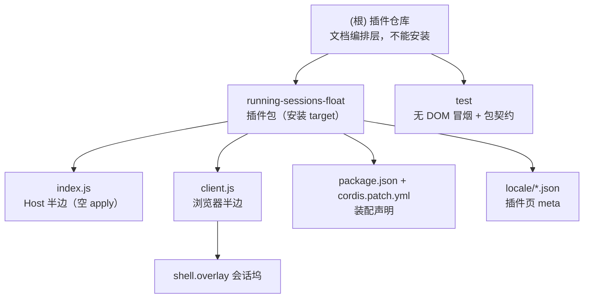

# AGENTS.md

给在这个仓库里干活的 agent 看的：命令、硬约束、改动连带项。面向用户的用法在 [README.md](README.md)，
设计取舍在 [IMPLEMENTATION.md](IMPLEMENTATION.md)。与代码冲突时以代码为准。

## 变更记录 (Changelog)

| 日期 | 变更 |
|---|---|
| 2026-10-20 | 初始化架构文档体系：补「模块结构」图与「模块索引」，新增模块级 [running-sessions-float/AGENTS.md](running-sessions-float/AGENTS.md) 与 [.agents/index.json](.agents/index.json)。下方原有命令、硬约束、连带项一字未改。 |
| 2026-10-20 | 发版一致性核对：「改动连带项」的版本行补「未发版期间允许无 tag，README 必须写明」；`.agents/index.json` 改记 `versionSource` 而非版本值，避免多出第 4 处副本。 |
| 2026-10-20 | 版本号纠偏：首版按阶梯定为 `0.1.0`（原 `1.0.1` 与仓库实际阶段不符）；`package.json`、README 版本行、README 预期输出三处同步；tag 当时未创建，README 暂写明「尚未打 git tag」。 |
| 2026-10-20 | 发布 `0.1`：提交并打附注 tag `0.1`（指向首个正式版本），推送 main 与 tag；README 版本段从「尚未打 tag」改为钉版本示例。 |
| 2026-10-20 | README 对齐 `note/readme-spec.md`：补「不提供」清单、装法四条坑（含 tag 钉版本与 git 直装限制）、`--dump-config` 期望输出、扩展点表的 priority / patterns 列与「不占槽位」、排错补到 12 行、验证拆分写明 15 + 6 = 21。 |

## 项目是什么

`@local/running-sessions-float` —— DSH 插件，一个包两半，但 **Host 半边是空的**：

- **Host 半边 [index.js](running-sessions-float/index.js)**：只有一个空 `apply()`，只给 bundle 一个挂载入口；
  无工具、无路由、无状态、无配置。
- **浏览器半边 [client.js](running-sessions-float/client.js)**：在 `shell.overlay` 注册一个固定定位的
  「进行中」坞，读标准 Hook `useSessions` / `useSessionStatus`，筛出 running / pending 的会话，
  点击走 `uiWorkspace.openSession`。

它不新增数据源、不轮询、不落盘、不改会话；样式与文案都在 `client.js` 里，无构建、无依赖。

## 命令

| 目的 | 命令 |
|---|---|
| 语法自检（两半） | `node --check running-sessions-float/index.js && node --check running-sessions-float/client.js` |
| 冒烟 + 包契约（21 项，先跑这个） | `node test/smoke.mjs` |
| 校验 manifest | `node -e 'const p=require("./running-sessions-float/package.json");console.log(p.name,p.version,p.dsh)'` |
| 校验 patch | `python3 -c "import yaml;print(yaml.safe_load(open('running-sessions-float/cordis.patch.yml')))"` |
| 装进 profile（宿主 shell） | `dsh plugin --profile web add "link:$(realpath running-sessions-float)"` |
| 卸载 | `plugin_manager` → `remove_bundle`，target `@local/running-sessions-float` |
| 看装配结果（宿主 shell） | `dsh --profile web --dump-config \| grep -A2 running-sessions-float` |

⚠️ `--dump-config` 装配前会写 profile 根文件 `cordis.yml`；在 `workspace-write` 沙箱里会 EROFS。
沙箱内用只读替代：`grep -n running-sessions-float ~/.dsh/profiles/web/package.json` 与
`ls -l ~/.dsh/profiles/web/node_modules/@local/`。

装的是 `link:`：profile 的 `package.json` 记
`"@local/running-sessions-float": "link:<仓库绝对路径>/running-sessions-float"`。

**改哪一半、怎么生效**：

| 改了什么 | 生效方式 |
|---|---|
| `client.js` | 刷新页面；Web 组合的 `client-hmr` 每 500ms 看 bundle 的 mtime / ctime / size，通常一两秒自动换新 |
| `index.js` | 目前为空；若将来写 Host 逻辑，要**重启 dsh**（loader 是裸 `import()`，重装不换模块） |
| `package.json` 的 `dsh.*` / `cordis.patch.yml` | 重新装配（GUI 安装 / 重装，或重启对应 profile） |

## 模块结构



## 模块索引

| 模块 | 路径 | 职责 | 入口 | 文档 |
|---|---|---|---|---|
| 插件包 | `running-sessions-float/` | 可安装单元：Host 空、浏览器半边注册坞 | `index.js` / `client.js` | [running-sessions-float/AGENTS.md](running-sessions-float/AGENTS.md) |
| 测试 | `test/` | 组件行为 + manifest / patch / 字典契约（21 项） | `test/smoke.mjs` | 本文件「验证规范」、README「怎么验证」 |

模块候选只有这两个：仓库根是文档编排层，没有 `package.json`，不能单独安装。

## 文件地图

```text
client.js        浏览器半边（318 行）：DICTS / CSS / useTranslator / pendingLabel / RunningSessionsDock / apply
index.js         Host 半边：8 行，空 apply()
cordis.patch.yml insert id=running-sessions-float → @local/running-sessions-float
package.json     dsh.bundle.patch + dsh.client { platform: web, immediately: true, inject: [session UI] }
locale/*.json    只有 meta.title / meta.description（插件页）
AGENTS.md（包内）模块级文档：职责 / 接口 / 数据形状 / FAQ（不进 npm files 白名单）
test/smoke.mjs   vm + React 桩渲染 + 包契约，21 项
.agents/index.json 扫描状态：模块清单 / 覆盖率 / 缺口 / 续扫入口
README.md        怎么用；IMPLEMENTATION.md 为什么；本文件 给 agent
```

## 代码风格

- 2 空格缩进、单引号、语句带分号；`client.js` 用 `React.createElement`（`h`），不写 JSX。
- CSS 类前缀 `rsf-`；颜色 / 边框 / 背景只用主题 token；阴影是固定 alpha。
- 中文 JSDoc；注释解释**为什么**（尤其过滤、待处理优先级、固定定位），不解释语法。
- 可见文案进 `DICTS`，不要在属性或子元素里写死中文。

## 硬约束（违反即出 bug）

1. **`client.js` 顶层只允许 `window.__ModuleLoader__.load({...})` 一个调用**；所有常量、函数放 factory 内。
   宿主把所有 client bundle 源码**拼成一个 classic script、不按包隔离作用域**；两个插件各写一个同名顶层
   `const` 会让整条 combo `SyntaxError`、**一个插件都不注册**，而报错完全不提撞名。`node --check` 单看
   本文件查不出来（这是 `dsh_editor` / `dsh_sidebar_terminal` 都踩过的坑）。
2. **只 `require('react')`**。要用别的客户端包，必须同时写进 `package.json` 的 `dsh.client.inject`，
   否则客户端模块解析不到。
3. **数据只走标准 Hook**：`useSessions` / `useSessionStatus` 都是官方快照。不要轮询 `agent/status`，
   不要新增 Host 路由 / 状态 —— 坞是聚合视图，不是第二份真相。
4. **过滤与优先级是契约**：`blank` 与 `origin === 'subagent'` 不进坞；有 `pendingInteraction` 的行
   **优先显示待处理**（即使 running 为真）；排序只看 `updatedAt` 降序。改任何一条同时改
   `test/smoke.mjs`、README「它怎么判断」与 IMPLEMENTATION「过滤规则」。
5. **slot 契约**：`shell.overlay` 是 list 槽，id `running-sessions-float`、order 60；该槽没有 patterns。
   注册必须走 `ctx.slots.inject('shell.overlay', () => ctx.slots.register(...))`，等槽位存在再注册。
6. **locale 两层**：界面文案只在 `client.js` 的 `DICTS`（zh / en 键必须完全一致，每个 `t('key')`
   两本都要有）；`locale/*.json` 只放插件页 `meta`。`test/smoke.mjs` 会双向查这两条。
7. **Host 半边保持空**：不要为了「方便」加工具 / 路由 / 状态。那会把纯客户端插件变成 Host 插件，
   生效条件、权限、验证与文档全要重写。
8. **样式只用主题 token**（`--dsw-alias-*`），不写死品牌色；现有唯一的硬编码是两层黑色阴影 alpha。
   不 import 官方 client 包（如 primitives），控件按宿主样式手写。
9. **无构建、无依赖、无 JSX**：`client.js` 是手写 ESM bundle，用 `React.createElement`（`h`）。
10. **安装 target 必须指到 `running-sessions-float/` 子目录**（仓库根没有 `package.json`）；不要手写
    profile 的 `package.json` / patch 文件；装 / 卸只走插件页或 `plugin_manager`。

## 已知设计（不是 bug）

- 固定 `left: 10px / bottom: 76px`，不随侧栏宽度 / 折叠移动，会盖住列表下半段 —— 取舍见 [IMPLEMENTATION.md](IMPLEMENTATION.md)。
- 空白会话与 subagent 会话不显示 —— 过滤是刻意的。
- 未知 `pendingInteraction.kind` 落到「等待回答」—— 归类兜底，不是漏了某个分支。
- 空态仍留一条细条 —— 保留固定座位，避免整块消失。
- 没有设置项 / 开关 / 快捷键 —— 装了就一直在，不想看只能卸载。

## 验证规范

改完至少跑：

```bash
node --check running-sessions-float/client.js
node --check running-sessions-float/index.js
node test/smoke.mjs   # 21 项，必须 ALL PASS
```

命令行证明不了的部分（位置、遮挡、主题、悬停、语言切换）照 README 的浏览器打勾清单人工核；
**不要声称跑过浏览器清单**，除非真的在页面里看过。

## 提交

中文 `类型(范围): 说明`，与同目录其它插件仓库一致：`功能(...)` / `修复(...)` / `重构(...)` /
`文档(...)` / `测试(...)` / `发布(...)`。提交后推送到 origin。

## 改动连带项

| 动了什么 | 必须同时改 |
|---|---|
| `client.js` 的过滤 / 排序 / 文案 / 状态归类 | `test/smoke.mjs` 断言、README「功能列表」「它怎么判断」「排错」、IMPLEMENTATION 对应节 |
| slot id / order / 注册方式 | README「扩展点占用表」、IMPLEMENTATION「注册时序」 |
| 新增 / 删除可见文案 | `DICTS` 的 zh 与 en 两份（键数必须相等）、README 功能表（如有新状态） |
| 行数 / 版本 | README「结构」表与「怎么验证」输出、`package.json`；发版三处一起动（version、tag、README 版本行）。未发版期间允许无 tag，但 README 必须写明「尚未打 git tag」 |
| `package.json` 的 `dsh.client` / `dsh.bundle` | README「生效条件」「结构」、本文件命令与生效表 |
| 新增依赖 / import | 本文件约束 2、`package.json` 的 `dsh.client.inject`、smoke 的「只 require react」断言（如放开） |
